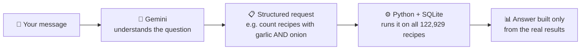

# 🍅 Recipe Box Kitchen

**A recipe chatbot that never makes things up.**
Ask questions about 122,929 real recipes, find dishes you can cook with what's in your fridge, and swap ingredients, with every answer backed by the actual data.


<!-- Add screenshots: save them in docs/screenshots/ and uncomment


-->

---

## 🤔 What problem does this solve?

If you ask a normal AI chatbot *"How many recipes contain garlic and onion?"*, it guesses.
When we tested this, Gemini on its own answered **36,499**, then **68,452**, then **36,251**: a different wrong number every time.

**Recipe Box Kitchen gets it right, every time: 16,090 recipes (13.09%)**, and it shows you exactly how it counted.

The trick: the AI is only used to **understand your question**. All the searching, counting, ranking and checking is done by regular code on the real dataset.

---

## ✨ What can it do?

### 🔎 1. Find recipes & answer questions
- Search by dish (*"penne pasta"*), ingredient (*"chicken and lemon"*) or description (*"something cozy for winter"*)
- Follow-ups remember the context: say *"I cannot have dairy"* and your current search is filtered, with evidence for every result
- Real statistics: counts, percentages, most common ingredients, averages, medians, rankings
- Every number tells you **what was filtered, how many recipes were analyzed, and how it was calculated**

### 🧺 2. Cook with what you have
- *"I have eggs, onions, tomatoes and rice. No peanuts, max 6 steps."*
- Ranks real recipes by how many of your ingredients they use
- Shows ✅ matched, ➖ missing and 🛒 extra ingredients for each recipe, plus *why* it's ranked there
- Your rules (allergies, max steps) are **never** quietly broken. If nothing fits, it says so.

### 🔄 3. Smart ingredient swaps
- *"Take this banana bread and remove the eggs."*
- Looks at similar recipes in the dataset that already work without that ingredient, and cites them by ID
- Gives you the **full adapted recipe**: new ingredient list and updated instructions
- Clearly labels what's a **prediction** (e.g. *"denser, moister crumb"*) and what's backed by data
- Refuses honestly when the evidence is too weak (e.g. removing eggs from a frittata)

### 🙅 It knows what it doesn't know
The dataset has no calories, cooking times or ratings, so when you ask for those, it tells you instead of inventing numbers.

---

## 💬 Example conversation

> **You:** Find a penne pasta recipe
> **Bot:** 🔎 495 matching recipes → shows top 5 with IDs and ingredients
>
> **You:** I cannot have dairy
> **Bot:** ✅ Added restriction: no dairy → 78 recipes left. Each one shows *"✔ checked all 7 ingredient lines – no dairy found"*
>
> **You:** Show me the instructions for the second one
> **Bot:** Shows the full original recipe for result #2
>
> **You:** How many calories does it have?
> **Bot:** I can't answer that from the dataset: it has no nutrition information, and I won't guess.

---

## 🚀 Getting started

**You'll need:** Python 3.10+ and a free Gemini API key from [Google AI Studio](https://aistudio.google.com/apikey).

```bash
# 1. Clone and enter the project
git clone <your-repo-url>
cd <your-repo-folder>

# 2. Create a virtual environment and install packages
python -m venv .venv
.venv\Scripts\activate          # Mac/Linux: source .venv/bin/activate
pip install -r requirements.txt

# 3. Download the dataset (about 50 MB zipped)
#    https://eightportions.com/recipes_raw.zip
#    Unzip the 3 JSON files into:  data/raw/

# 4. Build the recipe database (one time, about 6 minutes)
python -m recipebot.ingest

# 5. Add your API key
#    Copy .env.example to .env and paste your key after GEMINI_API_KEY=

# 6. Start cooking! 🍳
streamlit run app.py
```

Then open **http://localhost:8501**. Prefer the terminal? Run `python cli.py`.

---

## 🧠 How it works



1. **Gemini reads your message** and turns it into a structured request. That's all it's allowed to do.
2. **Python code runs the request** against the full dataset: searching, filtering, counting, ranking.
3. **The answer is built only from those results**, so there's nothing for the AI to invent.
4. Click **"🔍 How this was computed"** under any answer to see exactly what happened.

### Under the hood
- **Ingredient cleanup:** *"2 cups finely chopped red onions"* becomes `red onion`, which counts as an onion. But `onion powder` and `green onion` stay separate, because they're different products.
- **Allergy checks:** every ingredient line is checked against allergen word lists, with smart exceptions (coconut milk ≠ dairy, eggplant ≠ egg, peanut butter ≠ dairy).
- **Transparent scoring:** pantry matches use `10 × matched − 2 × extra ingredients`, shown on every result.
- **Evidence for swaps:** compares similar recipes *with* and *without* the ingredient, plus recipes titled *"eggless"*, *"dairy-free"* or *"vegan"*.

---


Run it yourself:
```bash
python -m pytest -q tests          # unit tests
python eval/run_eval.py            # evaluation (no API key needed)
python eval/run_eval.py --llm      # + AI tests and transcripts
```

---

## 📁 Project structure

```
├── app.py                  # 🎨 Streamlit web app
├── cli.py                  # 💻 Terminal version
├── recipebot/
│   ├── ingest.py           # Loads the dataset → SQLite database
│   ├── normalize.py        # Cleans ingredient names
│   ├── groups.py           # Allergy & diet rules (dairy, nuts, vegan…)
│   ├── store.py            # Search & filtering
│   ├── stats.py            # Counts, averages, rankings
│   ├── matcher.py          # "Cook with what you have"
│   ├── substitute.py       # Ingredient swaps
│   ├── agent.py            # Conversation memory & routing
│   ├── llm.py              # Gemini connection (with fallbacks)
│   └── render.py           # Formats the answers
├── assets/style.css        # 🍅 The food-themed look
├── eval/                   # Evaluation script & results
└── tests/                  # Unit tests
```

---

## 🛠️ Tech stack

| Part | Tool |
|---|---|
| Language | Python |
| Web interface | Streamlit |
| Database & search | SQLite with full-text search (FTS5 / BM25) |
| Data crunching | pandas |
| Language model | Google Gemini Flash (free tier) |
| Testing | pytest + custom evaluation |

---

## ⚠️ Known limitations

- **Step counts** depend on how each website formatted its instructions. Some write everything in one paragraph.
- **Allergy checks** read recipe text only. They can't see hidden ingredients inside packaged products. Always check labels.
- **Ingredient swaps** are based on what similar recipes do, not on kitchen testing. Effects are clearly marked as predictions.
- **Free Gemini tier** allows only a few requests per minute, so answers may slow down if you send many messages quickly.

---

## 📚 Dataset

[Recipe Box](https://eightportions.com/datasets/Recipes/) by Ryan Lee: about 125,000 recipes scraped from **Allrecipes**, **Epicurious** and **Food Network**. After removing empty or incomplete records, **122,929** recipes are used.

For detailed design decisions (normalization rules, scoring, evidence strength, what failed during development), see [docs/DESIGN.md](docs/DESIGN.md).


